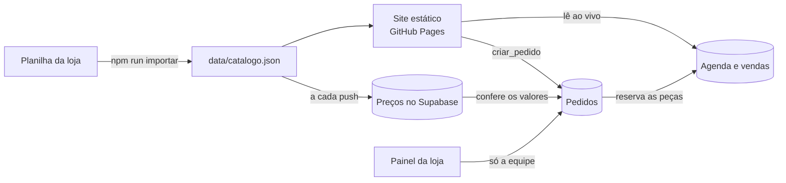

# Ateline · e-commerce de bolos cenográficos

Loja online da **Ateline Ateliê** ([@atelineatelie](https://www.instagram.com/atelineatelie)), um ateliê de bolos cenográficos na Praça Seca, Rio de Janeiro. Pelo site, a cliente **aluga** um bolo do acervo pela data da festa, **compra** um bolo para ficar com ela ou **encomenda** um bolo novo do jeito dela.

🔗 **Site no ar:** https://daniesolinho.github.io/ateline/


| Página do bolo, com calendário de disponibilidade | Catálogo no celular |
| --- | --- |
|  |  |

> As fotos dos bolos ainda estão sendo produzidas. Por enquanto, os cards mostram "Foto em breve".

## O problema

Hoje o atendimento da Ateline é todo pelo WhatsApp: a cliente pergunta se o bolo está livre, a loja confere a agenda, passa os valores, manda o contrato e cobra o sinal. O site automatiza esse caminho: mostra só o que está livre na data da festa, calcula retirada e devolução, reserva as peças no banco sem risco de duas clientes pegarem a mesma data, registra o aceite do contrato e dá à loja um painel com a agenda do dia.

## O que o site faz

- **Aluguel pela data da festa:** o calendário mostra, ao vivo, as datas em que a peça já está reservada. A retirada é no último dia de loja aberta antes da festa e a devolução no primeiro dia depois (a loja fecha domingo e segunda).
- **"Livres na sua data":** tocando num dia ocupado, a cliente vê outros bolos livres naquele dia (mesmo tema primeiro) e já abre o bolo com a data escolhida.
- **Montar a reserva:** tamanho (número de andares), decoração, topo opcional, base dourada e personalização (nome, idade ou inicial). O topo e a base também têm agenda própria.
- **Filtro "só livres nessa data"** no catálogo, além de busca por nome, tema e decoração.
- **Compra:** com 50% de sinal, retirada grátis na loja ou envio por transportadora. O CEP preenche o endereço sozinho (ViaCEP), e o orçamento do frete vai pronto para o WhatsApp da loja.
- **Encomenda:** formulário de orçamento para um bolo novo e a opção de **refazer** um bolo que saiu do acervo, com cupom de desconto e antecedência mínima de 20 dias.
- **Carrinho e checkout** com aluguel e compra no mesmo pedido, validação de CPF e telefone, aceite do contrato e chave Pix para devolver a taxa de segurança. O banco confere a agenda e os preços e reserva as peças por 2 horas, até o sinal ser pago.
- **Login sem senha** (link mágico por e-mail) e **Minha conta:** próxima retirada, histórico de pedidos com a situação de cada um e dados pessoais salvos na conta.
- **Painel da loja:** agenda do dia (o que sai, o que volta, o que está atrasado), confirmação de pagamento com um clique, checklist de devolução e a conta da taxa de segurança (multa por atraso, vela não devolvida, avaria).
- **Venda tira o bolo do acervo:** uma peça vendida some do aluguel e da venda sozinha.
- **Catálogo vindo de uma planilha:** a dona da loja cadastra os bolos no Excel, e um script valida e gera o JSON que o site usa.

## Tecnologias

- [Next.js 16](https://nextjs.org) (App Router) com exportação estática
- React 19 e TypeScript
- Tailwind CSS 4
- [Supabase](https://supabase.com): banco Postgres, login e regras de segurança (RLS)
- [Zod](https://zod.dev) para validar os formulários
- [Vitest](https://vitest.dev) para os testes das regras e [Playwright](https://playwright.dev) para os testes de ponta a ponta
- [ExcelJS](https://github.com/exceljs/exceljs) para importar a planilha
- GitHub Actions + GitHub Pages para testar e publicar a cada `git push`

## Como as partes se conectam



## Decisões técnicas

- **Site estático + Supabase, sem servidor próprio.** As páginas são geradas na hora de publicar (`output: "export"`, uma por bolo com `generateStaticParams`) e já saem com a agenda daquele momento. No navegador, a agenda é buscada de novo no Supabase, então uma reserva feita no painel aparece na hora.
- **O banco é quem decide.** A trava contra reserva dupla é uma *exclusion constraint* do Postgres (mesma peça + períodos que se cruzam), e o pedido é criado por uma função (`criar_pedido`) que confere a agenda, recalcula os valores com os preços do banco e reserva as peças numa só transação. Reservas sem sinal se soltam sozinhas depois de 2 horas.
- **Segurança por pessoa com RLS.** Visitante só lê a agenda pública; cada cliente só vê os próprios dados e pedidos; o painel e as ações da loja só funcionam para quem está na tabela da equipe. A chave secreta do Supabase fica só nos *secrets* do GitHub.
- **Regras de negócio em funções puras e testadas.** Datas, disponibilidade, valores, cupom, conta da taxa de segurança e validações ficam em `lib/`, separados das telas, com 112 testes. As regras de datas do banco foram comparadas com as do site para todos os dias de um ano.
- **Testes de ponta a ponta a cada push.** O Playwright abre o site publicado num navegador (computador e celular), aluga um bolo do catálogo até a confirmação e confere os avisos de data ocupada e bolo vendido, com o Supabase simulado. Se algum falhar, o site não é publicado.
- **Carrinho no navegador.** Fica no `localStorage`, lido com `useSyncExternalStore`, e as abas abertas ficam sincronizadas.
- **Planilha como fonte dos dados.** `npm run importar` lê `dados-fonte/catalogo.xlsx`, aponta erros (código repetido, preço faltando, topo inexistente) e só grava `data/catalogo.json` se estiver tudo certo. A cada push, o GitHub copia os preços para o banco.
- **Datas sem surpresa de fuso horário:** todas as contas com datas usam UTC e o formato `AAAA-MM-DD`.

## Acessibilidade e SEO

- Auditoria com [axe](https://github.com/dequelabs/axe-core) em todas as páginas, no computador e no celular, sem nenhum problema apontado nas regras WCAG 2.1 A e AA.
- Navegação completa pelo teclado, link "Pular para o conteúdo", contorno de foco visível e calendário com nomes completos das datas para leitores de tela.
- Título, descrição e link canônico em cada página, `sitemap.xml`, `robots.txt`, imagem de compartilhamento e dados estruturados da loja (schema.org).

## Como rodar no seu computador

Precisa do [Node.js](https://nodejs.org) 24 ou mais recente.

```bash
git clone https://github.com/DanieSolinho/ateline.git
cd ateline
npm install
npm run dev
```

Abra http://localhost:3000.

| Comando | O que faz |
| --- | --- |
| `npm run dev` | Site em modo de desenvolvimento |
| `npm test` | Roda os testes das regras (Vitest) |
| `npm run e2e` | Roda os testes de ponta a ponta (depois de `npm run build`) |
| `npm run lint` | Confere o código com o ESLint |
| `npm run build` | Gera o site estático na pasta `out/` |
| `npm run importar` | Lê a planilha e atualiza o catálogo |
| `npm run sincronizar` | Copia os preços para o Supabase (o GitHub faz sozinho a cada push) |

O banco é criado rodando, em ordem, os arquivos de `supabase/` no SQL Editor do Supabase.

## Estrutura

```
app/          páginas (rotas do App Router)
components/   componentes de tela, separados por página
hooks/        carrinho, login, agenda ao vivo e pedidos
lib/          regras de negócio e funções testadas
types/        tipos do catálogo, do carrinho e dos pedidos
data/         catálogo em JSON (gerado da planilha)
supabase/     tabelas, funções e regras de segurança do banco (SQL)
scripts/      importador da planilha e sincronização de preços
e2e/          testes de ponta a ponta (Playwright)
dados-fonte/  planilha preenchida pela loja
```

## Próximos passos

- Pagamento do sinal pelo Mercado Pago (Pix e cartão), com confirmação automática no painel
- E-mail próprio e domínio `ateline.com.br`
- Contrato em PDF, crédito em loja e adiamento pelo site
- Rascunhos de posts para o Instagram a partir da agenda ("livres neste fim de semana")
- Fotos dos bolos e kits "pegue e monte"

## Autora

Feito por **Daniella** ([@DanieSolinho](https://github.com/DanieSolinho)), desenvolvedora front-end, em parceria com a Ateline Ateliê.

